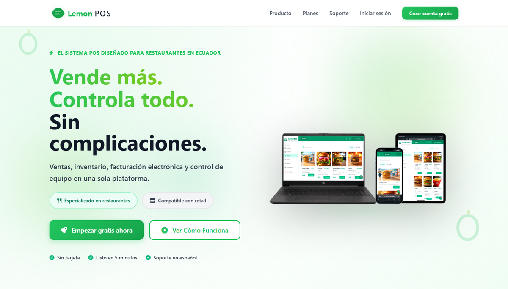
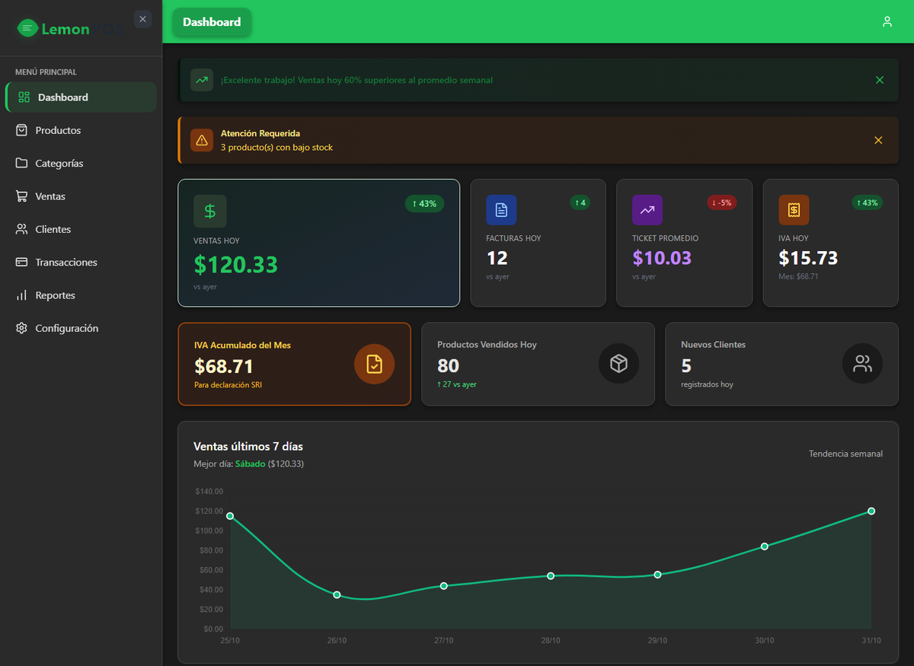
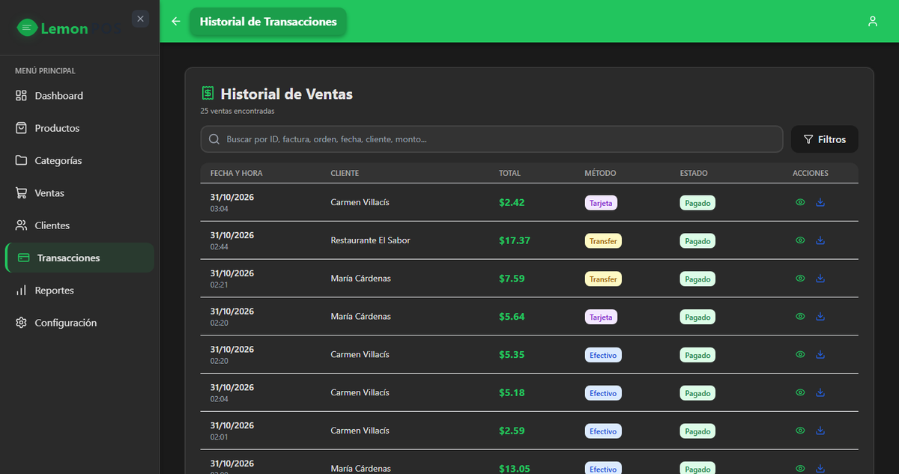

<p align="center">
  
</p>

<p align="center">
  
  
  
  
  
  
</p>

Sistema de punto de venta web para pequeños y medianos negocios en Ecuador. Lo empecé porque los POS que hay en el mercado son caros, están en inglés y no resuelven cosas que aquí son del día a día: facturar al SRI, el IVA del 15% y el "fiado".

Funciona, pero todavía no está terminado y no ha pasado por una prueba con negocios reales.

<p align="center">
  
</p>

## Qué hace

- **Ventas**: efectivo, tarjeta y transferencia, con descuentos y recargos. Cálculo de IVA en el carrito.
- **Caja**: apertura y cierre de turno con arqueo, y detección de faltantes.
- **Inventario**: stock en tiempo real, costos y alertas cuando un producto se está acabando.
- **Clientes y crédito**: límites de crédito, historial y cuentas por cobrar.
- **Modo restaurante**: pedidos por mesa, estados de la orden y pantalla de cocina (KDS).
- **Reportes**: rentabilidad por producto, ventas y cuentas por cobrar, con exportación a Excel y PDF.
- **Multi-negocio**: un solo sistema atiende a varios negocios con los datos separados.
- **Facturación electrónica SRI**: generación del XML y clave de acceso de 49 dígitos.

Está pensado para usarse desde celular, tablet o computador.

## Cómo se ve

Las capturas usan datos de demostración, no ventas reales.

**Dashboard**: ventas del día, tendencia de la semana, productos más vendidos y métodos de pago.

<p align="center">
  
</p>

**Historial de ventas**: búsqueda, filtros y descarga de cada comprobante.

<p align="center">
  
</p>

## Estado

| Listo | En desarrollo |
|---|---|
| Ventas, caja, inventario, clientes y crédito | Firma digital con certificado .p12 |
| Modo restaurante y cocina | Envío y autorización en el SRI |
| Reportes y exportación | RIDE en PDF |
| Generación de XML del SRI | Integración con WhatsApp y pasarelas de pago |

## Tecnologías

- Python / Django 4.2
- PostgreSQL
- Django Channels + Redis (actualizaciones en tiempo real)
- TailwindCSS
- Cloudinary para las imágenes de productos
- Despliegue en Render (hay `Dockerfile` y `render.yaml`)

## Cómo correrlo en local

Necesitas Python 3.11, PostgreSQL y una cuenta de Cloudinary (para las imágenes de productos).

```bash
python -m venv venv
venv\Scripts\activate        # en Linux/Mac: source venv/bin/activate
pip install -r requirements.txt
cp .env.example .env         # y completa tus propios valores
python manage.py migrate
python manage.py createsuperuser
python manage.py runserver
```

En `.env.example` están las variables que se necesitan (clave secreta, base de datos, Cloudinary). Usa tus propias claves, no hay ninguna incluida.

## Estructura

```
apps/
  clients/              clientes y crédito
  configuraciones/      ajustes del negocio
  core/                 base compartida
  electronic_billing/   facturación electrónica SRI
  productos/            productos e inventario
  reportes/             reportes
  transacciones/        movimientos y caja
  usuarios/             usuarios y permisos
  ventas/               ventas y órdenes
docs/                   notas de diseño y arquitectura
```

## Licencia

El código es público para que se pueda ver, aprender de él y probarlo. **Se puede usar libremente para fines personales, educativos y de evaluación, pero no para fines comerciales.**

Si quieres usarlo en un negocio, ofrecerlo como servicio, venderlo o basarte en él para un producto comercial, escríbeme primero. Si llegamos a un acuerdo, después de eso lo puedes usar como quieras.

Los detalles están en [LICENSE](LICENSE).

## Contacto

Justin Ocaña · [justin.ocana.molina@gmail.com](mailto:justin.ocana.molina@gmail.com) · [justin-ocana.github.io](https://justin-ocana.github.io/)
